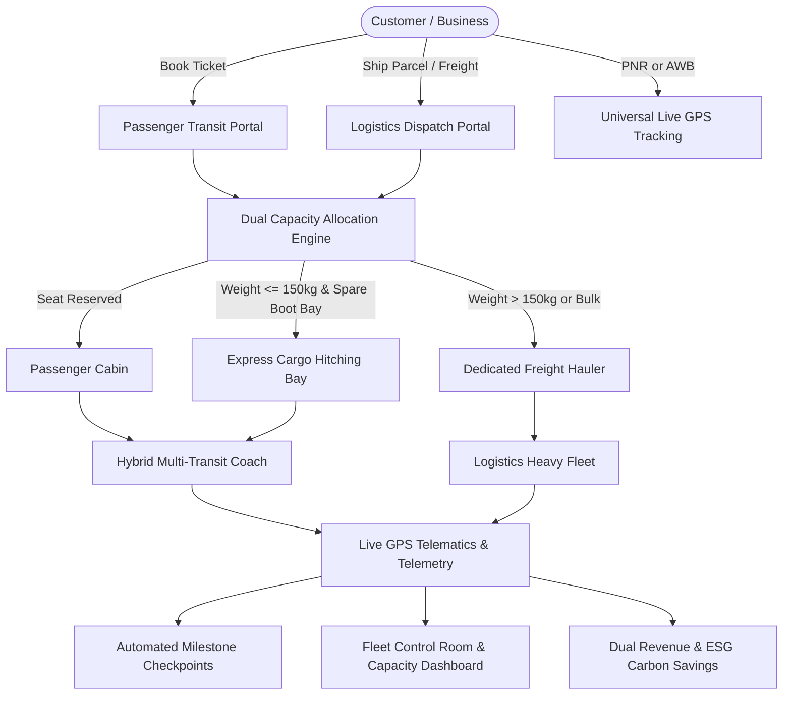

# 🚀 Dhanush OmniTransit & Logistics (DOTL)
### An Integrated Multi-Modal Passenger Travel & Express Freight Cargo Hitching Platform

[](https://www.python.org/)
[](https://palletsprojects.com/p/flask/)
[](https://www.sqlite.org/)
[](https://tailwindcss.com/)
[](https://leafletjs.com/)

---

## 🌟 1. Project Overview & Core Innovation

**Dhanush OmniTransit** is a next-generation transport management and telematics platform that solves a major inefficiency in modern transportation: **the separation of passenger mobility and goods logistics.**

### The Problem
- **Inter-city passenger coaches** often drive highways with 40% to 60% empty luggage and undercarriage boot space.
- **Logistics carriers** dispatch independent small trucks and vans between cities to deliver parcels, increasing traffic congestion, fuel burn, and carbon emissions.

### The Solution: "Cargo-Hitching"
Dhanush OmniTransit unifies both operations under a synchronized dual-transit protocol:
1. **Passenger Rides**: Commuters reserve seats on intercity routes (Bangalore, Chennai, Hyderabad, Coimbatore, Mysore).
2. **Express Cargo Hitching**: Consignments under 150 kg (e-commerce parcels, electronics, medicines, perishables) are hitched onto scheduled passenger buses with spare boot volume, delivering parcels **3x faster** (same-day delivery) at **30% lower cost**.
3. **Dedicated Heavy Freight**: Heavy machinery or palletized cargo (> 150 kg) is automatically routed to dedicated 8-10 ton freight carriers.
4. **Unified Live Telematics**: Passengers and cargo consignees track the exact vehicle moving their journey on an interactive Leaflet GPS map with checkpoint milestone verification.

---

## 🏗️ 2. System Architecture



---

## ⚙️ 3. Key Modules & Features

| Module | Features & Capabilities |
| :--- | :--- |
| **Passenger Booking Portal** | Filter by terminal hubs, choose seats (Window/Aisle), instant PNR confirmation, generate digital boarding pass with verification code. |
| **Logistics & Freight Dispatch** | Automated weight & category calculations, intelligent mode routing (*Express Cargo-Hitch* vs *Dedicated Heavy Freight*), instant electronic Consignment Note / Waybill with AWB barcode. |
| **Universal Live GPS Tracking** | Universal search box accepting both **PNR** (travelers) and **AWB** (shipments). Live Leaflet.js map with route polyline, vehicle position, speed, and milestone logs. |
| **Dual-Manifest Transparency** | Real-time transparency alert showing fellow travelers and the exact weight/types of cargo parcels safely secured in the undercarriage deck. |
| **Fleet Dispatch Control Room** | Visual dual-capacity utilization gauges: **Passenger Seat Occupancy %** alongside **Cargo Bay Payload %**. Interactive simulation button to advance vehicle GPS position (+15%). |
| **Executive Analytics & ESG** | Revenue diversification breakdown (Passenger Fares vs Logistics Freight), corridor profitability tables, and calculated **CO₂ emissions averted**. |

---

## 🚀 4. Quick Start Guide

### Prerequisites
- Python 3.10+ installed on your computer.

### Step 1: Open Terminal in Project Directory
```powershell
cd "d:\dhanush transport"
```

### Step 2: Install Dependencies (if not already installed)
```powershell
python -m pip install -r requirements.txt
```

### Step 3: Seed Initial Data
Pre-populates sample transit hubs (Bangalore, Chennai, Hyderabad, Coimbatore, Mysore), hybrid coaches, freight trucks, active trips, and sample bookings:
```powershell
python seed_data.py
```

### Step 4: Run the Application
```powershell
python app.py
```

Open your browser and navigate to:
👉 **`http://127.0.0.1:5000`**

---

## 🧪 5. Automated Unit Tests

A comprehensive unit test suite is included (`test_routes.py`) that tests all endpoints, form submissions, PNR ticket creation, cargo waybill creation, and telematics simulation.

Run tests:
```powershell
python test_routes.py
```

Expected output:
```text
Ran 11 tests in 0.317s
OK
```

---

## 🔍 6. Demo Tracking Numbers

You can test the universal tracking search directly with these pre-seeded references:
- **`PNR-DT-882101`**: Passenger Aditya Sharma traveling Bangalore &rarr; Chennai.
- **`AWB-DT-10081`**: Express electronics shipment hitched on the **same bus** as Aditya Sharma!
- **`AWB-DT-90050`**: Heavy industrial castings moving via a dedicated 10T freight truck.

---

## 🗄️ 7. Database Schema (SQLite)

- **`hubs`**: Transit terminals & depots with GPS lat/lng and contact details.
- **`vehicles`**: Hybrid buses, express minivans, and freight trucks with seat count and cargo payload capacity (kg & m³).
- **`routes`**: Origin hub, destination hub, distance (km), travel time, base fare, base cargo rate.
- **`trips`**: Scheduled and live journeys with current GPS coordinates, progress percentage, booked passenger count, and booked cargo payload.
- **`passenger_bookings`**: PNR, passenger contact, seat number, fare, status, and digital QR tokens.
- **`cargo_consignments`**: AWB tracking code, sender and receiver details, package weight, cargo category, assigned transit mode, price, and status.
- **`tracking_checkpoints`**: Chronological milestone log for both passengers and cargo shipments.

---

## 📄 License & Credits
Developed for the **Dhanush Transport** multi-transit initiative. Built with Python, Flask, SQLite, Tailwind CSS, and Leaflet.js.
